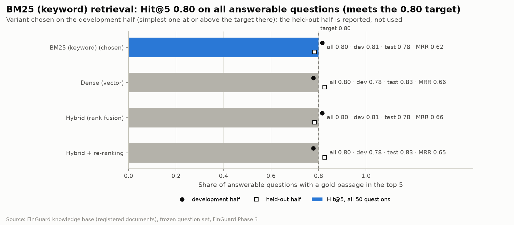
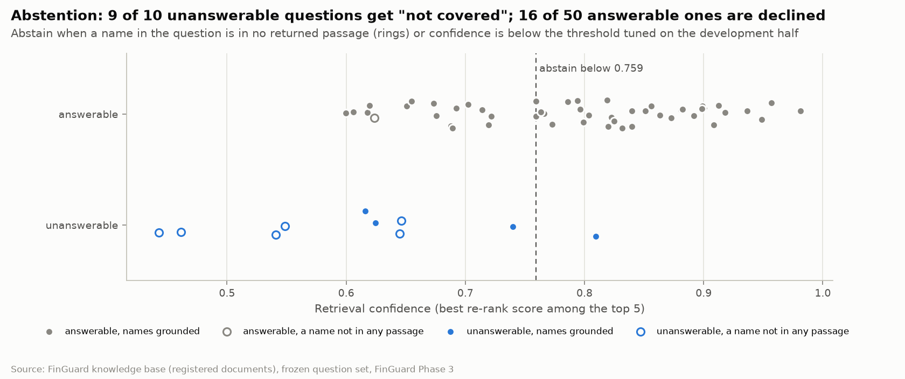

# FinGuard AI · Phase 3 Knowledge Base Report

**Scope:** the knowledge base behind the `policy_search` tool: 11 registered documents, hybrid retrieval with
abstention, and its evaluation on a frozen question set
**Produced by:** `python -m finguard.rag build`, `python -m finguard.rag evaluate` and notebook `10` (executed
outputs committed)
**Date:** 2026-10-29

## 1. Verdict

The knowledge base meets both exit criteria of Project Report v3.0, one at its limit and one at a high price.
A gold passage is among the top five results for **40 of 50** answerable questions (Hit@5 0.80, 95% interval
0.67–0.89), and **9 of 10** unanswerable questions get "not covered by the sources". To get there, the
abstention rule also declines 16 of the 50 answerable questions.

| Exit criterion (Project Report v3.0) | Target | Result | Status |
| --- | --- | --- | --- |
| Corpus with registry and checksums | 10–14 documents | 11 documents (8 published, 3 project); SHA-256 for every file | Met |
| Heading-based chunks with overlap | 300–500 tokens | 74% of text chunks in 300–500 (median 389); 12% overlap within a section | Mostly met |
| Questions written before indexing | 40–50 answerable, 10 unanswerable | 50 and 10, frozen by SHA-256 before the first evaluation | Met |
| Retrieval quality | Hit@5 ≥ 0.80 | 0.80 on all questions; 0.81 on the development half, 0.78 on the held-out half | Met at the limit |
| Abstention | ≥ 8 of 10 | 9 of 10; 16 of 50 answerable questions declined | Met, at a high cost |
| Versioned corpus and index; retrieval test in CI | Required | Registry hashes, index version, frozen questions; CI tests | Met |
| Deliverable | Retrieval service and evaluation report | `policy_search` tool, this report, notebook 10 | Met |

Three facts frame these numbers:

- **No neural model could be downloaded in this environment.** The "dense" retriever is latent semantic
  analysis (TF-IDF plus SVD) and the re-ranker is a fixed lexical blend. Both are weak on paraphrase, so a
  keyword index alone did as well as the hybrid. The code accepts a multilingual embedding model and a
  cross-encoder through two settings, and the same evaluation then decides again.
- **The question set is small.** One held-out question moves Hit@5 by 0.04, and only five unanswerable
  questions were available to tune abstention.
- **The set was evaluated six times.** Every change after the first run was chosen on the development half;
  section 9 records each run, including one rule that was tried and dropped.

## 2. What the knowledge base is for

When an analyst works an alert, the agents need sources for three questions: what the pattern means, what to
check next, and what the institution's obligations are if fraud is confirmed. The knowledge base returns cited
passages for these questions, or says the sources do not cover them. It does not "verify a transaction against
regulation": the model scores the transaction, and the passages give context for the analyst's decision.

## 3. Corpus

Eleven documents are registered in `corpus/registry.json`, each with publisher, date, jurisdiction, tier,
language, URL and SHA-256. Every build checks each file against its hash and refuses a changed one.

| Document | Publisher | Date | Jurisdiction | Tier | Lang. | Pages | Chunks |
| --- | --- | --- | --- | --- | --- | --- | --- |
| 2025 report on payment fraud (EBA/REP/2025/40) | EBA and ECB | 2025-12 | EU | 1 | en | 49 | 99 |
| Guidelines on fraud reporting under PSD2 (EBA/GL/2018/05), consolidated | EBA | 2018-07 (amended 2020) | EU | 1 | en | 140 | 215 |
| Cyber-enabled fraud, Annex A: risk indicators | FATF, INTERPOL, Egmont Group | 2023-11 | International | 1 | en | 4 | 4 |
| Visa Dispute Management Guide for Merchants | Visa | 2026-10 | Card network | 1 | en | 112 | 108 |
| FraudClassifier model and definitions | Federal Reserve | 2020-06 | US | 1 | en | 3 | 5 |
| Using the FraudClassifier and ScamClassifier models together | Federal Reserve | 2026-03 | US | 1 | en | 6 | 4 |
| The FATF Recommendations (updated June 2026) | FATF | 2026-06 | International | 2 | en | 151 | 172 |
| Circulaire 2017-08 (amended by 2018-09), AML/CFT internal control | Banque Centrale de Tunisie | 2017-09 | TN | 3 | fr | 16 | 33 |
| FinGuard data glossary (measured IEEE-CIS facts) | FinGuard project | 2026-10 | Dataset | 1 | en | — | 4 |
| FinGuard feature and reason-code glossary (generated from code) | FinGuard project | 2026-10 | Project | 1 | en | — | 8 |
| FinGuard investigation playbook (**fictional**) | FinGuard project | 2026-10 | Project | 3 | en | — | 5 |

Tier 1 covers card-not-present fraud and the system itself, tier 2 AML/KYC obligations, tier 3 jurisdiction
and internal documents. The `policy_search` tool can filter on tier and jurisdiction.

**Published documents are not stored in the repository.** They are copyrighted, so the registry keeps their
URL and hash; `python -m finguard.rag register-dir FOLDER` copies in every downloaded file whose hash matches,
whatever its name, and `register FILE --doc-id ID` records a new version deliberately.
**Project documents are.** The data glossary states only facts measured in Phase 1 and marks the one
statement taken from the competition host, the label definition. The reason-code glossary is generated from
the code and the Phase 2 artifacts, so it cannot drift from the model. The playbook is fictional and says so
in its title and first line, and its `fictional` flag travels with every passage the tool returns.

**Two planned documents are missing:** FATF Guidance on Digital Identity and the competition host's data
description. Neither file was available in this build. Both stay in the registry under `not_included` with
their URLs, ready to be added.

## 4. Parsing and chunking

PDFs are parsed with pdfplumber into headings, text and tables, with page numbers; Markdown is parsed by its
`#` headings. The rules, most of them found on real documents:

- **Running headers and footers removed:** lines repeated near the page edge on many pages, bare page numbers
  and "Page 3 of 49" lines. A header in small type that changes part-way through a consolidated document
  counts as repeated from 10% of pages.
- **Headings:** lines larger than the body text, short bold lines, or lines starting with a structural keyword
  (Article, Recommendation, Guideline and their French forms). "Guideline 3: Frequency, reporting timelines…"
  set large stays one heading; "Art. 5 (nouveau) – text…" in body type is split into heading and text; a
  sentence citing "Guideline 1.1" or "Article 18 of the RTS" is not a heading.
- **Noise removed:** tables of contents, dot leaders, chart axis labels, raised footnote markers and service
  marks ("FraudClassifierSM" becomes "FraudClassifier"), shadow text drawn twice, private-use symbol glyphs.
- **Diagrams:** on a flowchart page, the labels are kept as text but never become section headings.
- **Tables** found by pdfplumber become blocks of their own and their lines are removed from the text.

Chunks never cross a top-level section. A sub-section shorter than 300 tokens absorbs the next one, whose
heading stays inline in the text and is listed in the chunk's `subsections`, so a citation names every section
a passage spans. Long sections are cut at sentence ends into 400-token chunks (maximum 500) with 12% overlap.
Tables of 120 tokens or more are chunks of their own, split by rows with the header repeated; smaller tables
stay in the text. Each chunk is indexed with its document title and section path prepended.

| Chunks | Count | Within 300–500 tokens | Median tokens |
| --- | --- | --- | --- |
| Text | 449 | 74% | 389 |
| Table | 208 | — | — |
| All | 657 | — | — |

Of the 93 text chunks under 300 tokens, 34 end at a top-level section or the end of a document, which the rule
never crosses, and 26 stop where a large table begins.

## 5. Retrieval

Four variants were built and compared:

| Variant | How it ranks |
| --- | --- |
| BM25 (keyword) | Okapi BM25, k1 = 1.5, b = 0.75. Tokens keep identifiers whole ("10.4", "R.16", "EBA/GL/2018/05") and also index their parts; plurals are folded; accents are removed for matching only |
| Dense (vector) | Cosine similarity of embeddings. Here: LSA, TF-IDF over words and word pairs reduced to 256 dimensions. With `FINGUARD_EMBEDDER` set: a sentence-transformers model, e.g. multilingual E5 |
| Hybrid | BM25 top 30 and dense top 30 merged by reciprocal rank fusion (k = 60) |
| Hybrid + re-ranking | The fused top 30 re-scored. Here: a fixed blend of query-term coverage (0.45), dense similarity (0.35), BM25 (0.20) and exact identifier matches (0.10), set before evaluation. With `FINGUARD_RERANKER` set: a cross-encoder |

The rule written before the first run keeps the simplest variant whose Hit@5 reaches 0.80 on the development
half. `policy_search` uses the chosen variant automatically.

## 6. How it was evaluated

**Questions.** 60 questions were written from the documents' text before any retrieval run: 50 answerable,
each with its gold document and a short quoted span, and 10 unanswerable but in the domain (other card
schemes, figures the documents do not give, Tunisian statistics). They span all 11 documents, include four in
French and one English question about the French circular. The file was frozen by SHA-256 on 2026-10-29 at
14:23, before the first evaluation; evaluation refuses to run if it changed, and CI checks the hash.

**Gold.** A chunk is a hit when it belongs to the gold document and contains the quoted span after
normalisation. The gold therefore survives re-chunking, but it is strict: an equivalent passage elsewhere does
not count. Doc@5, the gold document among the top five, is reported as the looser check.

**Two halves.** Questions alternate between a development half (27 answerable, 5 unanswerable) and a held-out
half (23 and 5). Misses were studied, fixes chosen and thresholds tuned on the development half only. The
held-out half is reported every time but never used to choose.

## 7. Results

| Variant | Hit@1 | Hit@5 | Hit@5, development | Hit@5, held-out | Doc@5 | MRR@10 |
| --- | --- | --- | --- | --- | --- | --- |
| **BM25 (keyword), chosen** | 0.50 | **0.80** | 0.81 | 0.78 | 0.98 | 0.619 |
| Dense (LSA) | 0.56 | 0.80 | 0.78 | 0.83 | 0.98 | 0.662 |
| Hybrid (rank fusion) | 0.54 | 0.80 | 0.81 | 0.78 | 0.98 | 0.656 |
| Hybrid + re-ranking | 0.56 | 0.80 | 0.78 | 0.83 | 0.98 | 0.651 |



All four variants find a gold passage for 40 of 50 questions; they differ in how high they rank it. The fused
and dense variants rank it higher (MRR 0.66 against 0.62), but on the development half only BM25 and the
plain hybrid reach 0.80, and BM25 is the simpler. With 23 held-out questions, the interval around 0.78 runs
from 0.58 to 0.90, so the halves do not differ meaningfully.

The ten misses of the chosen variant:

| Question | Half | Rank of the gold passage | Why it is missed |
| --- | --- | --- | --- |
| q02 What prior transactions are needed to use Compelling Evidence 3.0? | held-out | beyond 10 | Many near-identical CE3.0 passages in the Visa guide |
| q03 How recent must the earlier transactions be for a CE3.0 response? | dev | beyond 10 | Paraphrase: "how recent" vs "within 365 calendar days" |
| q17 Which fraudulent payment transactions must PSPs report under the EBA guidelines? | dev | 6 | Every passage of the guidelines shares these words |
| q19 How often do PSPs report fraud statistics under PSD2? | dev | 10 | Paraphrase: "how often" vs "every six months" |
| q20 What is meant by modification of a payment order by the fraudster? | held-out | beyond 10 | Definition sits in an annex table among similar ones |
| q25 Which fraud type makes up most of the value of fraudulent credit transfers? | dev | 10 | Paraphrase: "most of" vs "more than half" |
| q26 Does strong customer authentication reduce card fraud rates? | held-out | beyond 10 | The answer is spread over chart commentary |
| q30 Quelles fonctions doit offrir le système d'information… (French) | held-out | beyond 10 | Right circular, neighbouring article |
| q33 Under the Tunisian circular, may a bank keep a relationship with a shell bank? | dev | beyond 10 | English question, French document: no multilingual model |
| q38 How does the FraudClassifier model define a manipulated authorized party? | held-out | 8 | Short definitions in a flowchart layout |

In nine of the ten misses the right document is in the top five; only the cross-lingual question (q33) fails
at document level. Most misses are paraphrases, which is what a neural embedding model or a cross-encoder
fixes and what a keyword index cannot.

## 8. Abstention

The tool answers "not covered by the sources" when either check fails:

1. **Grounding.** Every name in the question (a capitalised word that does not start the sentence, an acronym,
   or an identifier such as "R.16") must appear in the returned passages or in their document's title,
   publisher or jurisdiction. A question about Ethoca answered from passages that never name it fails this check.
   The check has no parameter, and the tool returns the missing names.
2. **Confidence.** The best re-rank score among the top five must reach a threshold. The threshold is tuned on
   the development half alone, for the best balanced accuracy between answering answerable questions and
   abstaining on unanswerable ones: 0.759.

| Rule | Unanswerable abstained, dev | Held-out | All | Answerable declined (all) | Hit@5 after abstention |
| --- | --- | --- | --- | --- | --- |
| **Grounding + threshold (chosen)** | 5/5 | 4/5 | **9/10** | 16/50 | 0.60 |
| Threshold only | 5/5 | 4/5 | 9/10 | 16/50 | 0.60 |
| Grounding only | 4/5 | 2/5 | 6/10 | 1/50 | 0.80 |



The grounding check is precise: it declines one answerable question (the cross-lingual one, already a miss) and
catches every unanswerable question that names something absent from the corpus (Mastercard, American
Express, Ethoca, Tunisia, the CTAF). But it cannot catch a question whose words are all in the corpus, such as
"the UK reimbursement limit for push-payment scams" or "the highest-fraud browser family in the later period".
Those fall to the confidence threshold, and the lexical confidence separates them poorly from answerable
questions: to catch them, the threshold also declines a third of the answerable ones.

The threshold is an operating choice between wrong answers and declined questions:

| Threshold | Unanswerable abstained, dev | Held-out | All | Answerable declined, dev | Held-out | All |
| --- | --- | --- | --- | --- | --- | --- |
| 0 (grounding only) | 4/5 | 2/5 | 6/10 | 1/27 | 0/23 | 1/50 |
| 0.60 | 4/5 | 2/5 | 6/10 | 1/27 | 1/23 | 2/50 |
| 0.65 | 4/5 | 4/5 | 8/10 | 4/27 | 1/23 | 5/50 |
| 0.70 | 4/5 | 4/5 | 8/10 | 8/27 | 4/23 | 12/50 |
| **0.759 (chosen)** | 5/5 | 4/5 | 9/10 | 9/27 | 7/23 | 16/50 |

On the development half alone, 0.65 scores almost the same balanced accuracy as 0.759 (0.826 against 0.833)
while declining 4 answerable questions instead of 9. The tuning rule chose 0.759 by a small margin, and five
development questions cannot settle the choice. **Recommendation:** keep 0.759 as the evaluated setting, let
the fraud-operations lead decide the operating point, and confirm it on a larger, newly written question set.
The threshold sits in `data/corpus/index/abstention.json`.

## 9. Evaluation history

The frozen set was evaluated six times. Each change after run 1 was chosen by reading misses on the
development half; the held-out half was reported each time and never used to choose. One exception is marked:
run 4's rule was adopted after run 3's held-out result was known, so its held-out abstention figures are not a
clean held-out estimate.

| Run | Variant | Hit@5 all | Dev | Held-out | Abstained | Answerable declined | What changed |
| --- | --- | --- | --- | --- | --- | --- | --- |
| 1 | Hybrid + re-ranking | 0.76 | — | — | 9/10 | 6/50 | First evaluation: initial parser and tokenizer, threshold-only abstention |
| 2 | Hybrid + re-ranking | 0.80 | 0.81 | 0.78 | 8/10 | 9/50 | Parser fixes from development misses (section 4) and plural folding |
| 3 | Hybrid + re-ranking | 0.80 | 0.81 | 0.78 | 7/10 | 1/50 | Grounding check added, threshold tuned together with it: the threshold fell to 0 and failed on the held-out half (2/5). Dropped |
| 4 | Hybrid + re-ranking | 0.80 | 0.81 | 0.78 | 9/10 | 9/50 | Threshold tuned alone, then combined with the grounding check |
| 5 | BM25 | 0.80 | 0.81 | 0.78 | 9/10 | 16/50 | Chunks brought to the 300–500-token design; variant chosen automatically on the development half |
| 6 | **BM25** | **0.80** | 0.81 | 0.78 | **9/10** | 16/50 | Evaluation fix: confidence measured over the top 5 passages the tool returns, not the top 10. Results unchanged |

Run 5's chunking raised Hit@5 or MRR for three of the four variants on the development half, and lifted the
share of text chunks within 300–500 tokens from 31% to 74%. It also made BM25 the simplest variant at the
target. The larger chunks shifted the confidence scores too, and the re-tuned threshold declines 16 answerable
questions instead of 9. The variant switch does not explain the rise: on the new chunks, hybrid + re-ranking
declines the same 9 development questions as BM25. The full log is `reports/tables/phase3_retrieval_runs.json`.

## 10. The `policy_search` tool

Read-only. Input: a query and optional tier and jurisdiction filters. Output, as JSON:

- `status` "ok" with passages S1–S5. Each passage carries document title, publisher, date, jurisdiction, tier,
  language, URL, section path, inline sub-sections, pages, text, score, and the `fictional` flag;
- or `status` "not_covered" with the message "Not covered by the sources." and the names the sources do not
  mention;
- in both cases the confidence, the threshold, the index version, the embedder and the re-ranker, so an answer
  can be traced to the exact index that produced it.

Examples from notebook 10:

```text
Q: What does Visa dispute condition 10.4 cover and what evidence can the merchant provide?
   status ok · S1 Visa Dispute Management Guide › Visa Dispute Categories and Conditions › What's Covered, pp. 84-85
Q: Which FATF Recommendation requires reporting suspicious transactions?   (tier 2)
   status ok · S1 FATF Recommendations › 18. Internal controls… + inline 19. Higher-risk countries,
               20. Reporting of suspicious transactions, pp. 19-20
Q: What is the Mastercard reason code for card-not-present fraud?
   status not_covered · confidence 0.72 below 0.759 · "Not covered by the sources."
Q: What does the Mastercard Ethoca alert service do?
   status not_covered · "Not covered by the sources. The sources found do not mention: Ethoca."
```

The tool returns sources and never interprets them; the agent that writes the answer must cite S-labels, and
the citation check planned for the agent phase verifies that every claim points to a returned passage.

## 11. Versioning and CI

| What | How it is versioned | Checked by |
| --- | --- | --- |
| Documents | SHA-256 per file in the registry | Every build (a changed file is refused); CI checks project documents |
| Index | Version = hash of every chunk's indexed text plus the embedder name; manifest lists document hashes | Written with each build and returned with every search |
| Question set | SHA-256 and date in `corpus/questions_frozen.json` | Evaluation refuses a changed file; CI checks it |
| Evaluation | Each run logged with its index version | `phase3_retrieval_runs.json` |
| Retrieval code | Unit tests on a synthetic corpus: parsing, chunking, BM25 by hand, filters, citations, grounding, abstention tuning | CI on every push |
| Retrieval quality | Regression test: chosen variant Hit@5 ≥ 0.78 and ≥ 8/10 abstentions | Runs wherever the index is built (CI skips it: the published PDFs are not in Git) |

## 12. Also in this delivery: Phase 2 completed

The five Phase 2 items that the first Phase 2 run left out are now done; details are in the Phase 2 Model
Report, section 11.

- **Novelty flags** are readable, but they add nothing to the ranking. They are shown next to the score, not
  blended into it.
- **Isolation Forest** is not used. Alone it reaches PR-AUC 0.117; as an extra input it changes PR-AUC by −0.0002.
- **The baseline gap** came from the first baseline's preprocessing. The strengthened baseline (0.459) is the
  new bar, and LightGBM clears it by +0.122.
- **The scorer** returns a 0–100 score capped at 1–99, the band, novelty flags and the top-5 reasons with
  their anonymized signal groups; online scoring equals batch scoring.
- **The model gate** passed 11 of 11 checks, and the model is registered as `lgbm_numeric-v1`. Promotion to
  champion needs a named person's approval.

## 13. Limitations and next steps

- **Lexical models only.** Install `sentence-transformers`, set `FINGUARD_EMBEDDER=intfloat/multilingual-e5-small`
  and `FINGUARD_RERANKER=cross-encoder/mmarco-mMiniLMv2-L12-H384-v1`, rebuild and re-evaluate. This is the first
  thing to try: it targets the paraphrase misses, the cross-lingual miss and the weak confidence signal behind
  the declined questions.
- **A small question set, tuned and evaluated six times.** Before production, write a fresh set of 100 or more
  questions, at least 30 of them unanswerable, with analysts, and evaluate once.
- **The operating threshold** is a decision for the fraud-operations lead (section 8).
- **Two planned documents missing** (FATF digital identity guidance, the host's data description).
- **Section paths in very long documents can be imperfect**, for example interpretive notes nested under the
  last recommendation. Pages are always exact, and citations give pages.
- **Coverage, not correctness.** Retrieval finds passages; whether the agent's answer is faithful to them is
  measured in the agent phase.

## Reproduce

```bash
python -m finguard.rag register-dir PATH/TO/PDF-FOLDER   # published PDFs, matched to the registry by SHA-256
make kb            # parse, chunk, index (about 2 minutes)
make kb-eval       # evaluate on the frozen questions; writes the tables and abstention.json
make kb-notebook   # notebook 10
python -m finguard.rag search "Visa 10.4 compelling evidence" --tier 1
make test          # unit tests
```

## Figure and table index

| Figure | File |
| --- | --- |
| 27 · Retrieval variants, Hit@5 by half | `figures/fig27_retrieval_variants.png` |
| 28 · Abstention per question | `figures/fig28_abstention.png` |

Tables (`reports/tables/`): `phase3_retrieval_summary.csv`, `phase3_retrieval_details.csv`,
`phase3_retrieval_results.json`, `phase3_retrieval_runs.json`, `phase3_summary.json`. Index build report:
`data/corpus/index/build_report.json`.
