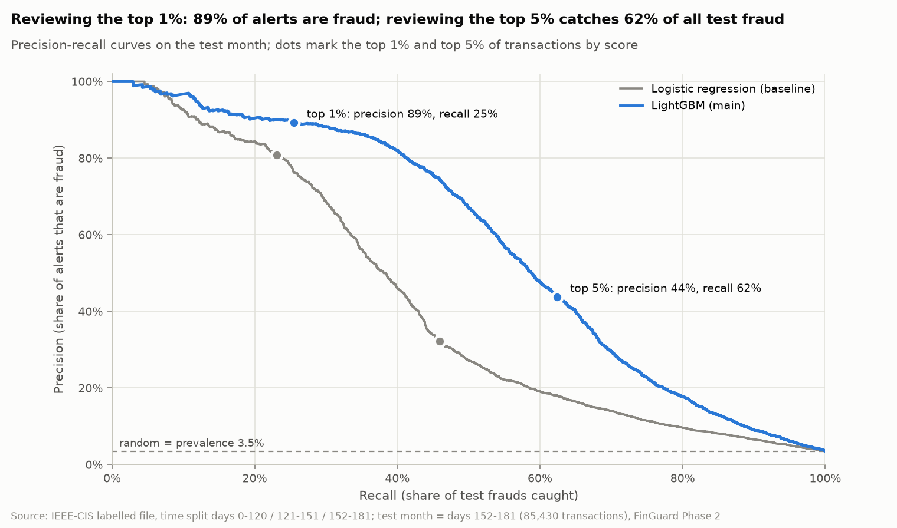
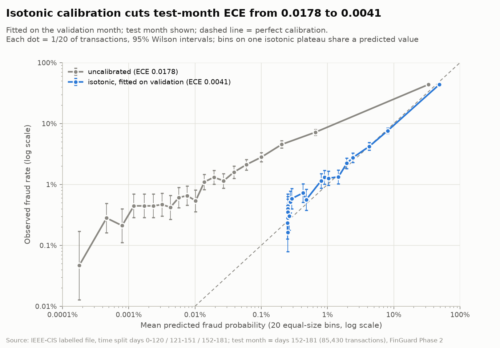
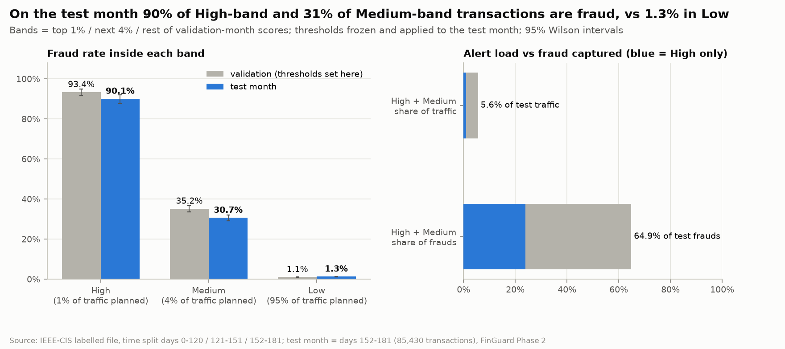
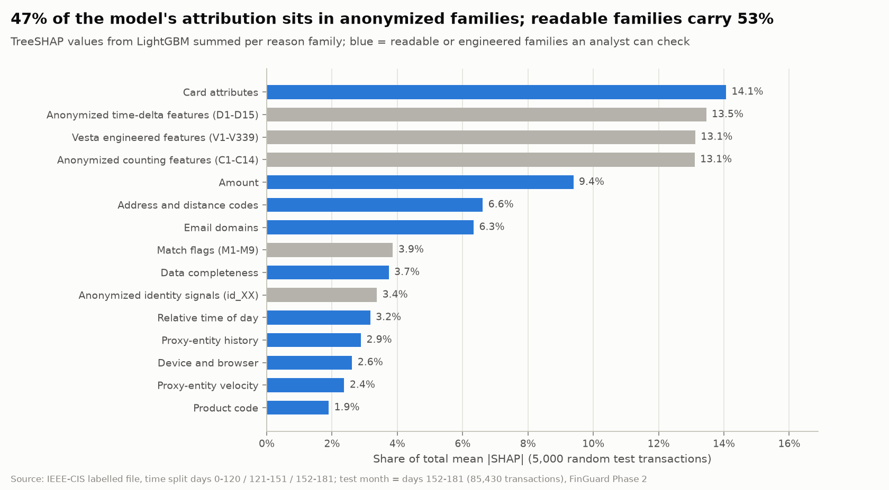
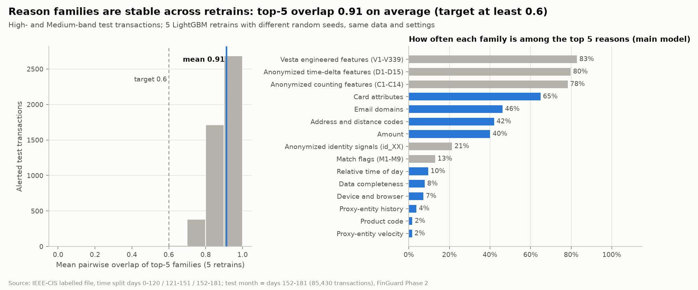
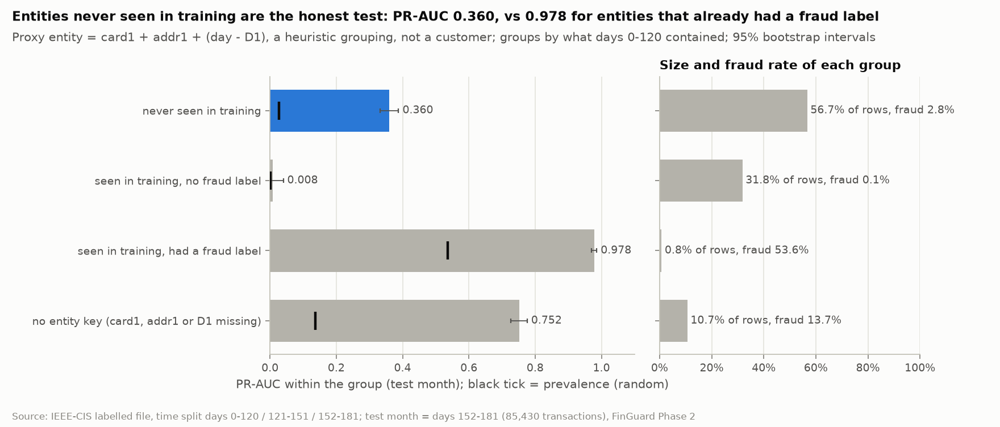
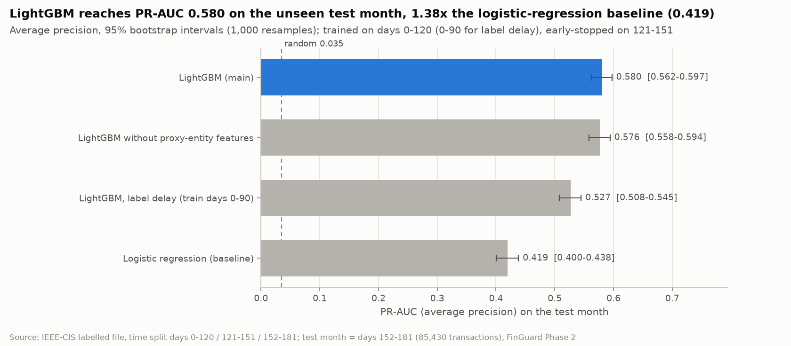
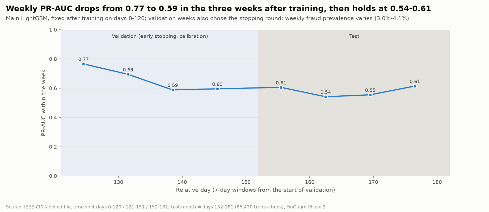

# FinGuard AI · Phase 2 Model Report

**Dataset:** IEEE-CIS Fraud Detection (Kaggle, Vesta), labelled file, time split 0–120 / 121–151 / 152–181
**Produced by:** `python -m finguard.phase2` and notebooks `05`–`08` (executed outputs committed), 35 unit tests
**Date:** 2026-10-27

## 1. Verdict

Phase 2 delivers a calibrated LightGBM model that clearly beats the baseline on an unseen month. It is
ready to feed Phase 3 as a decision aid. Two caveats shape Phase 3: much of the accuracy comes from
recognising proxy entities with earlier fraud, and most of the reasons are anonymized.

| Question (test month, days 152–181) | Answer |
| --- | --- |
| How good is the main model? | PR-AUC 0.580 (0.552–0.609); baseline 0.419 |
| What does a review team get? | Reviewing the top 1% of traffic: 89% of alerts are fraud. Reviewing the top 5%: 62% of all fraud caught |
| Are the probabilities trustworthy? | ECE 0.0041 after isotonic calibration, but 4–5 points too high in the alert range |
| Do the risk bands hold? | High 90.1% fraud, Medium 30.7%, Low 1.3%; alert volume 5.62% of traffic instead of 5% |
| Are the reasons stable and readable? | Stable: top-5 overlap 0.91 across retrains (target 0.6). Mostly anonymized: the first reason has no disclosed meaning for 80.5% of alerts |
| Detection or recognition? | Never-seen proxy entities: PR-AUC 0.360. Entities with earlier fraud: 0.978 |
| What do late labels cost? | A 30-day delay costs 0.054 PR-AUC |
| Do proxy-entity features help? | +0.004 PR-AUC, no larger than the seed-to-seed spread |

What Phase 3 should build on these results:

- Lead every alert with its band; show the calibrated probability second, capped at ">99%".
- Monitor band shares daily and weekly PR-AUC as labels arrive; refit the calibrator each labelled month.
- Feed confirmed fraud back fast: label latency is the largest measured loss.
- Mark each reason as checkable (readable family) or not (anonymized family).

## 2. Set-up

Every model is fitted on days 0–120, tuned on days 121–151 and scored once on days 152–181. No statistic
sees a later day than the period it serves.

| Period | Relative days | Transactions | Frauds | Used for |
| --- | --- | --- | --- | --- |
| Training | 0–120 | 417,559 | 14,721 (3.53%) | All feature statistics; fitting every model |
| Validation | 121–151 | 87,551 | 2,948 (3.37%) | Early stopping, code-encoding choice, the baseline's C, isotonic calibration, band thresholds |
| Test | 152–181 | 85,430 | 2,994 (3.50%) | Scored once; every result in this report |
| Label-delay variant | training 0–90 | 319,934 | 10,882 (3.40%) | Sensitivity run: days 91–120 (97,625 rows) left out, as if their chargebacks had not arrived |

Validation serves several purposes, so validation scores are optimistic: LightGBM reaches PR-AUC 0.659
there and 0.580 on test. Only test numbers are reported as results.

### Rules enforced in code

| Rule | How it is enforced | How it is checked |
| --- | --- | --- |
| Time split only | `split.check` refuses overlapping or unordered windows | 3 unit tests |
| Point-in-time proxy-entity features | Each transaction sees only earlier transactions of its proxy entity (time order, then file order) | 4 unit tests (future rows, single-transaction scoring vs batch, file order, hand-computed values); on the real data, removing all rows after day 120 changes no training-row value (max difference 0.0) |
| Training-window statistics | Vocabularies, frequencies, amount deciles, NaN blocks and missing patterns fitted on days 0–120, then frozen | Unit test: rewriting later rows leaves every fitted statistic unchanged; fit rows = 417,559 |
| No target encoding | Labels are never read by the feature builder | Unit test: flipping every label leaves the features identical |
| Forbidden inputs (TransactionID, raw TransactionDT, label, day, entity key) | The builder raises if one appears | Unit test and real-data check |
| Honest names | Grouping features are `entity_*`; no feature is called "customer" | Unit test |
| Missingness kept visible | NaN kept for trees; 23 block-presence flags, a missing count and a missing-pattern code (55 patterns) | Feature list |

IEEE-CIS has no customer identifier. The proxy entity is card1 + addr1 + (day − D1), a heuristic grouping
available for 88.7% of rows; the other 11.3% get empty entity features, never a guessed key.

### The feature set

The matrix has 474 columns: 473 for the trees, plus `amt_decile` for the linear model only. Of these, 62 are
engineered or re-expressed and 31 are categorical. 403 of the 474 sit in the five anonymized families
(V, id_XX, D, C, M), which is why explanations are given per family (section 7).

| Family | Columns | Engineered or re-expressed | Meaning disclosed |
| --- | --- | --- | --- |
| Vesta engineered features (V) | 339 | 0 | no |
| Identity signals (id_XX) | 26 | 0 | no |
| Data completeness | 26 | 25 | yes |
| Time-delta features (D, D·n) | 15 | 9 | no |
| Counting features (C) | 14 | 0 | no |
| Card attributes | 10 | 4 | partly (network, type) |
| Device and browser | 9 | 8 | yes |
| Match flags (M) | 9 | 0 | no |
| Address and distance codes | 6 | 2 | no |
| Email domains | 6 | 4 | yes |
| Proxy-entity history | 4 | 4 | yes |
| Proxy-entity velocity | 4 | 4 | yes |
| Amount | 3 | 2 | yes |
| Relative time of day | 2 | 0 | yes (relative only) |
| Product code | 1 | 0 | no |

## 3. Logistic-regression baseline

The baseline reaches test PR-AUC **0.419** (95% interval 0.400–0.438), 12 times the random level of 0.035.
It is the bar every other model must clear.

**Preprocessing**, fitted on days 0–120 only, produces 621 inputs:

- card and address codes are represented by their training-window frequencies, never as numbers;
- 76 columns that duplicate another column of the same NaN block (|r| ≥ 0.95) are dropped;
- a signed log is applied to 293 heavy-tailed columns (|skew| > 2), then median imputation and standardisation;
- missingness enters through the block flags plus 41 single-column indicators;
- each of the 31 categorical columns gets one-hot columns for its 30 most frequent levels, plus "other".

C = 0.01 was chosen on validation PR-AUC (0.448), from a grid of 0.001–1.0 whose ends scored 0.435 and 0.443.

| Period | PR-AUC | ROC-AUC | Precision, top 1% | Recall, top 1% | Precision, top 5% | Recall, top 5% |
| --- | --- | --- | --- | --- | --- | --- |
| Validation | 0.448 | 0.853 | 81.1% | 24.1% | 34.9% | 51.9% |
| Test | 0.419 | 0.852 | 80.9% | 23.1% | 32.2% | 45.9% |

The design review's exploratory baseline reached 0.445 on the same test month. It used looser preprocessing:
card and address codes and the raw, time-trending D columns entered as numbers. Which difference explains the
0.026 gap has not been isolated.

The largest coefficients are C13 (−1.41) and C1 (+1.24), two correlated counting columns with opposite signs.
That is collinearity, not opposite meanings, so linear coefficients are not used as explanations.

## 4. LightGBM main model

LightGBM reaches test PR-AUC **0.580** (95% interval 0.552–0.609 when whole proxy entities are resampled),
0.161 above the baseline. All 1,000 paired resamples favour it.

**Model choice, on validation only.** Two variants with identical settings differ in how the six numeric codes
(card1/2/3/5, addr1/2) enter. As raw numbers they reach validation PR-AUC 0.659 after 2,638 rounds; as
training-window categories, 0.652 after 1,015 rounds. Raw numbers were chosen. The other variant was also
scored on test (0.564) but played no part in the choice.

**Settings:** 473 inputs, learning rate 0.05, 127 leaves, at least 100 rows per leaf, 50% of features and 80%
of rows per tree, L2 penalty 1.0. Training stops after 100 rounds without a validation gain in average precision.

| Test-month metric | LightGBM | 95% interval, transactions | 95% interval, proxy-entity blocks | Logistic regression |
| --- | --- | --- | --- | --- |
| PR-AUC | 0.580 | 0.562–0.597 | 0.552–0.609 | 0.419 |
| ROC-AUC | 0.907 | 0.900–0.913 | 0.895–0.918 | 0.852 |
| Precision, top 1% (854 alerts) | 89.2% | 87.3–91.5% | 86.9–91.9% | 80.9% |
| Recall, top 1% | 25.5% | 24.5–26.4% | 23.8–27.3% | 23.1% |
| Precision, top 5% (4,272 alerts) | 43.7% | 42.1–45.4% | 40.7–47.0% | 32.2% |
| Recall, top 5% | 62.4% | 60.9–64.1% | 59.6–65.3% | 45.9% |

Transactions of one proxy entity are correlated, so the entity-block interval is the honest one. It is about
1.6 times wider than the per-transaction interval.

**Paired difference, LightGBM minus baseline** (same 1,000 resamples): PR-AUC +0.161 (0.147–0.175), recall at
top 1% +2.4 points (1.7–3.2), recall at top 5% +16.5 points (14.8–18.1).



The two models agree on the very top of the ranking. The gap opens beyond the top 1%: at a 5% review budget
LightGBM catches 62% of test fraud, the baseline 46%.

## 5. Calibration

Isotonic calibration, fitted on the validation month, cuts test ECE from 0.0178 to **0.0041** and lowers the
Brier score from 0.0221 to 0.0208. It never changes the ranking.

| Test month (observed fraud rate 3.50%) | Brier score | ECE, 10 equal-count bins | Mean predicted probability |
| --- | --- | --- | --- |
| LightGBM, uncalibrated | 0.0221 | 0.0178 | 1.73% |
| LightGBM, isotonic | 0.0208 | 0.0041 | 3.64% |
| Logistic regression, isotonic | 0.0260 | 0.0080 | 4.19% |
| Constant 3.50% (no model) | 0.0338 | — | 3.50% |



The raw LightGBM probability is far too low for most transactions: its lowest bins predict about 0.001% where
0.3–0.5% are fraud. Isotonic calibration fixes that.

The weak spot is the alert range. Calibrated probabilities overstate test-month risk there by 4–5 points: 93.9%
predicted vs 90.1% observed in the High band, 35.0% vs 30.7% in Medium. The calibrator learned validation-month
rates (93.4% and 35.2% in these bands), and the same scores carry less fraud a month later. Validation also
chose the stopping round, which flatters it slightly. Phase 3 should lead with the band and show the
probability as secondary, and refit the calibrator on each new labelled month.

## 6. Risk bands

With thresholds frozen from validation, the High band is **90.1%** fraud on the test month and Medium
**30.7%**, against 1.3% in Low. Together High and Medium are 5.6% of traffic and hold 64.9% of test fraud.

| Band | Raw-score threshold | Calibrated probability at threshold | Planned share | Test share of traffic | Test transactions | Test fraud rate (95% interval) | Share of test frauds |
| --- | --- | --- | --- | --- | --- | --- | --- |
| High | ≥ 2.500 | ≥ 87.1% | 1% | 0.93% | 794 | 90.1% (87.8–91.9%) | 23.9% |
| Medium | ≥ −4.527 | ≥ 11.0% | 4% | 4.69% | 4,003 | 30.7% (29.2–32.1%) | 41.0% |
| Low | below −4.527 | — | 95% | 94.38% | 80,633 | 1.30% (1.23–1.39%) | 35.1% |



The alert volume moved: High and Medium took 5.62% of test traffic instead of the planned 5%, about 12% more
review work. Band shares are the first drift alarm Phase 3 must watch.

Thresholds sit on the raw score, which ranks exactly like the calibrated probability but has no isotonic plateaus.

## 7. Explanations

Reason families are stable: across five retrains, an alert's top-5 families overlap **0.91** on average,
against a target of 0.6. They are also mostly anonymized: for 80.5% of alerts, the strongest reason has no
disclosed meaning.

**Method.** LightGBM's own TreeSHAP values (`pred_contrib`) are summed into 15 reason families, and they add up
exactly to the model score (largest error 1.9 × 10⁻⁹ log-odds). Each alert lists the families that pushed its
score up most, up to five. Fixed templates word each family, stating only values found in the transaction.



Across all test traffic, readable and engineered families carry 53% of the attribution. Card attributes lead
(14.1%), then the anonymized D, V and C families at about 13% each, then amount (9.4%). The two proxy-entity
families carry 2.9% and 2.4%.



On the 4,797 alerts (High and Medium), anonymized families crowd the top: V is among the top 5 for 83% of
alerts, D for 80%, C for 78%. Every alert still shows at least one readable family, most often card attributes
(65%), email domains (46%), address codes (42%) or amount (40%). All 4,797 alerts reach an overlap of at least
0.6, and 77.5% keep the same first reason in all five retrains.

An example reason card, a High-band transaction from the test month:

```text
TransactionID 3548165 | band High | calibrated fraud probability >99%
1. Vesta engineered features (V1-V339): meaning not disclosed by the data provider. [+7.30 log-odds]
2. Anonymized counting features (C1-C14): meaning not disclosed by the data provider. [+6.01 log-odds]
3. Card attributes: network mastercard, type credit; card1 code seen 129 time(s) in the training window (card codes are undisclosed). [+1.54 log-odds]
4. Email domains: purchaser gmail.com, recipient gmail.com. [+0.84 log-odds]
5. Anonymized time-delta features (D1-D15): meaning not disclosed by the data provider. [+0.81 log-odds]
```

The calibrator assigns exactly 100% to 163 test transactions, and 2 of them were legitimate. Displayed
probabilities are therefore capped at ">99%" and "<1%" (`calibration.display_probability`, unit-tested).
More cards: `reports/tables/phase2_reason_examples.txt`; all alerts: `reports/tables/phase2_reason_cards.csv`.

## 8. Robustness

Part of the headline is recognition rather than detection. On proxy entities never seen in training (57% of
test traffic), PR-AUC is **0.360**. On the 0.8% of transactions from entities that already had a fraud label,
it is 0.978.

### New vs known proxy entities

Test transactions are grouped by what days 0–120 contained. Labels are used only to form the groups, never as
features.

| Test-month group | Share of transactions | Share of test frauds | Fraud rate | PR-AUC (95% interval) | Recall in the global top 5% |
| --- | --- | --- | --- | --- | --- |
| Never seen in training | 56.7% | 45.0% | 2.8% | 0.360 (0.332–0.388) | 43.2% |
| Seen in training, no fraud label | 31.8% | 1.2% | 0.14% | 0.008 (0.002–0.040) | 2.7% |
| Seen in training, had a fraud label | 0.8% | 11.9% | 53.6% | 0.978 (0.970–0.986) | 80.3% |
| No entity key (card1, addr1 or D1 missing) | 10.7% | 42.0% | 13.7% | 0.752 (0.726–0.776) | 79.6% |



PR-AUC within a group depends on its fraud rate. For never-seen entities, 0.360 is 13 times the group's random
level. Recognising entities with earlier fraud is legitimate in production only if those labels have arrived,
which the label-delay run tests. Transactions without an entity key are 10.7% of traffic but 42.0% of fraud:
the missing key is itself a strong signal.

### Label delay, ablation and the baseline



| Compared with the main model (paired, 1,000 resamples) | PR-AUC difference | 95% interval |
| --- | --- | --- |
| Label delay: training on days 0–90 only | −0.054 | −0.062 to −0.045 |
| Without the 8 proxy-entity features | −0.004 | −0.008 to −0.0002 |
| Logistic-regression baseline | −0.161 | −0.175 to −0.147 |

- **Label delay costs about a tenth of the PR-AUC.** Without the 30 days of labels just before validation,
  recall at the top 5% falls from 62.4% to 56.5%. That run stopped at 2,934 of its 3,000-round cap, with no
  validation gain in its last 66 rounds.
- **The proxy-entity features add little.** Across test resamples their lift is detectable (2.5% show no
  gain), but it is no larger than the spread between random seeds (below), so it is not established. The
  anonymized counting (C) and time-delta (D) columns likely carry similar history already.

### Over time



Weekly PR-AUC is 0.77 in the first week after training, 0.59 by the third, then holds at 0.54–0.61 through the
test month. Recognition explains much of the early level: entities already labelled fraud supply 28.7% of
frauds in the first validation week, and 8–14% in each test week.

### Random seed

Five retrains with other seeds, the same data and the same number of rounds score test PR-AUC 0.573–0.578. The
main model's 0.580 is the highest of the six, and the mean is 0.577 (standard deviation 0.002). Every
conclusion above holds within that spread, except the 0.004 lift from proxy-entity features, which is the same size.

## 9. Scorecard against the design-review reference

Eight of 13 checks meet the reference and three fall short by less than their own 95% interval. One ties at
reported precision, and one misses: the logistic-regression baseline, at 0.419 against 0.445.

The references come from the design review's exploratory run: scikit-learn HistGradientBoosting, fewer
engineered features, the same time split. They are a bar to clear, not a contract. Intervals here resample
test transactions; the entity-block intervals of section 4 are wider.

| Test-month metric | Reference | Phase 2 | 95% interval | Status |
| --- | --- | --- | --- | --- |
| PR-AUC, main model | 0.546 | 0.580 | 0.562–0.597 | Met |
| PR-AUC, logistic regression | 0.445 | 0.419 | 0.400–0.438 | Below reference |
| ROC-AUC, main model | 0.899 | 0.907 | 0.900–0.913 | Met |
| Precision at top 1% | 90.2% | 89.2% | 87.3–91.5% | Within 95% interval |
| Recall at top 1% | 25.7% | 25.5% | 24.5–26.4% | Within 95% interval |
| Precision at top 5% | 40.5% | 43.7% | 42.1–45.4% | Met |
| Recall at top 5% | 57.8% | 62.4% | 60.9–64.1% | Met |
| ECE after isotonic calibration (lower is better) | 0.004 | 0.0041 | — | Equal at reported precision |
| High-band fraud rate | 90.6% | 90.1% | 87.8–91.9% | Within 95% interval |
| Medium-band fraud rate | 26.7% | 30.7% | 29.2–32.1% | Met |
| Low-band fraud rate (lower is better) | 1.5% | 1.30% | 1.23–1.39% | Met |
| Top-5 reason-family overlap across 5 retrains | ≥ 0.6 | 0.91 | — | Met |
| Brier score after calibration | below uncalibrated 0.0221 | 0.0208 | — | Met |

The review measured the whole test month only. On never-seen proxy entities alone, which the review did not
measure, the model scores 0.360 (section 8).

## 10. Limitations, hand-over to Phase 3 and reproduction

The model can serve Phase 3 as a decision aid, through its bands and family reasons, under six limits that
must stay visible in every report and screen.

- **No customer identifier.** The proxy entity is a heuristic and can merge or split real people. Section 8
  shows how much of the score rests on entities seen before.
- **403 of the 474 model columns are anonymized.** Reasons from those families say "meaning not disclosed";
  analysts can check only the readable and engineered families.
- **The label definition cannot be verified.** Labels are chargeback-based and propagated to linked
  transactions, per the data host. The label-delay run (section 8) measures sensitivity to late labels.
- **No geography, merchant or customer attributes.** Fairness across customer groups cannot be measured with
  this data.
- **One period, one fixed model.** Weekly PR-AUC drops over the three weeks after training, then levels off
  (section 8). In the alert range, calibrated probabilities overstate test-month risk by 4–5 points
  (section 5), and alert volume rose from 5% to 5.62% (section 6).
- **Validation is reused** for early stopping, model choice, calibration and band thresholds. Test numbers are
  clean; validation numbers are optimistic.

### What Phase 3 receives

| Item | File | Fitted on |
| --- | --- | --- |
| Feature builder: vocabularies, frequencies, NaN blocks, missing patterns | `artifacts/phase2/model_bundle.pkl` | Days 0–120 |
| LightGBM model: 2,638 trees, 473 inputs | `artifacts/phase2/lgbm_numeric/model.txt` | Days 0–120 |
| Isotonic calibrator | `artifacts/phase2/model_bundle.pkl` | Days 121–151 |
| Band thresholds: raw score 2.500 (High), −4.527 (Medium) | `artifacts/phase2/model_bundle.pkl` | Days 121–151 |
| Reason families and templates | `src/finguard/explain/reasons.py` | Fixed rules |

Scoring one transaction online needs an entity store holding each proxy entity's earlier transactions: time,
amount, device brand and email domain. A unit test proves that single-transaction scoring reproduces the batch
values exactly.

Left out of Phase 2 by design: the Isolation Forest experiment, the AML module, and the agents, RAG, API and
dashboard.

### Reproduce

```bash
make data validate      # checksums, id-XX fix, join; data-quality checks
make phase2             # pipeline, about 1.5–2 h on 2 CPU cores, resumable stage by stage
make phase2-notebooks   # notebooks 05–08 (make phase2-fallback without Jupyter)
make test               # 35 unit tests
```

## Figure and table index

| Figure | File |
| --- | --- |
| 17 · PR-AUC of the four models | `figures/fig17_model_comparison.png` |
| 18 · Precision-recall curves | `figures/fig18_precision_recall_curves.png` |
| 19 · Reliability before and after calibration | `figures/fig19_reliability.png` |
| 20 · Risk bands, validation vs test | `figures/fig20_risk_bands.png` |
| 21 · Weekly performance | `figures/fig21_weekly_performance.png` |
| 22 · New vs known proxy entities | `figures/fig22_new_vs_known_entities.png` |
| 23 · Attribution by reason family | `figures/fig23_reason_family_importance.png` |
| 24 · Reason stability across retrains | `figures/fig24_reason_stability.png` |

Tables (`reports/tables/`): `phase2_split.csv`, `phase2_feature_families.csv`, `phase2_test_metrics.csv`,
`phase2_results.json` (intervals, calibration, bands), `phase2_bands.csv`, `phase2_reliability.csv`,
`phase2_family_importance.csv`, `phase2_feature_shap.csv`, `phase2_reason_cards.csv`,
`phase2_reason_examples.txt`, `phase2_explanations.json`, `phase2_seed_variance.csv`,
`phase2_entity_groups.csv`, `phase2_model_comparison.csv`, `phase2_weekly.csv`, `phase2_scorecard.csv`.
